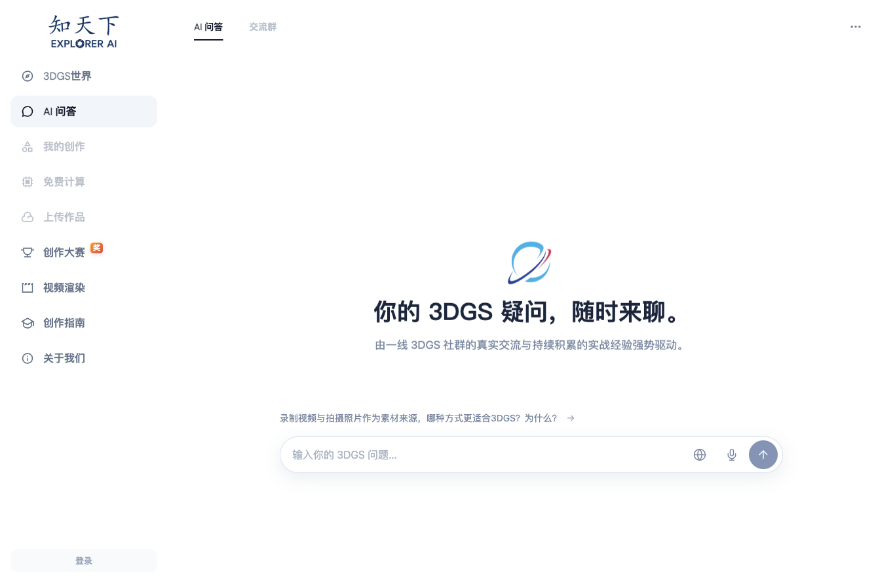
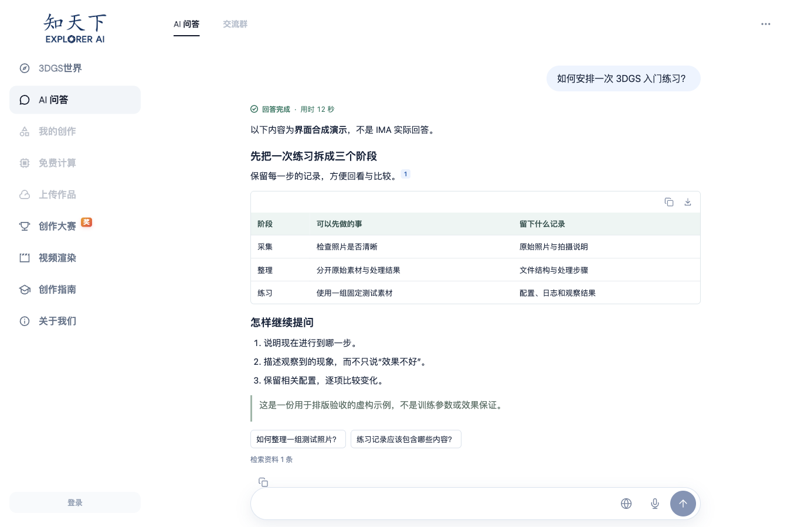
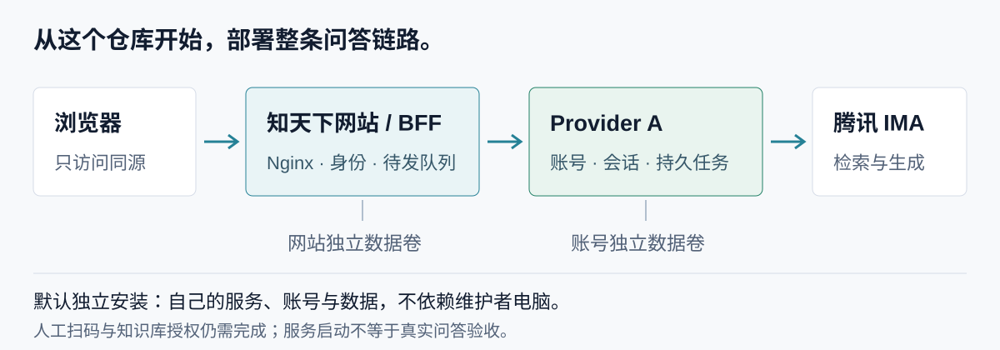

# 知天下 AI 问答


[静态首图](assets/readme/hero-aperture-static.png)

**把社群持续积累的 3DGS 知识，变成可以连续追问的网站体验。**

本仓库交付知天下品牌前端与同源 BFF；底层问答由独立的 [IMA QA Web Agent / Provider A](https://github.com/19Chris19/ima-qa-web-agent) 提供。**无需先手工部署两个仓库**：从这里进入，工具选择匹配的 Provider、镜像与独立数据卷。

[在线体验](https://explorer-ai-qa-demo.vercel.app/) · [开始部署](#开始部署) · [Agent 部署说明](docs/AGENT_DEPLOYMENT.md) · [主站接入](#接入知天下主站) · [稳定 Release](https://github.com/19Chris19/explorer-ai-qa-demo/releases/latest)

## 先看体验





截图为**当前源码的合成演示**，不是真实 IMA 回答、实际容量或线上验收证明。使用真实品牌资产，未包含账号、凭证或用户历史；见 [图片来源与生成说明](assets/readme/ASSETS.md)。

| 阅读与提问 | 具体行为 |
| --- | --- |
| 紧凑输入 | 胶囊输入栏随文字量展开；候选问题只填入草稿，不自动发送 |
| 回答不中断阅读 | 向上阅读停止追滚，居中按钮回到最新；断网后续接原任务 |
| 下一问排队 | 生成期间继续写问题，可编辑／删除待发项；上一轮成功后顺序派发，同会话最多 3 条 |
| 清晰展示 | 安全 GFM、表格横向滚动、引用与来源预览；过程区只接受明确上游事件 |
| 复制与导出 | 正文复制、划词复制、表格复制／CSV；未完成回答保留已收到部分 |

## 两个仓库，一条闭环



```text
浏览器 → 网站入口 Nginx → 知天下 BFF → Provider A → 腾讯 IMA
                          网站身份       账号与会话
                          待发队列       持久任务与调度
                          独立数据卷     独立数据卷
```

回答沿原路流式返回。浏览器只访问网站同源接口，不取得 Provider 原始凭证。Provider 负责 IMA 登录、授权、账号池与任务；本仓库不复制第二份登录实现，也不是 Provider 的 fork。

默认 Compose 启动 **Nginx、网站 BFF、专用 Provider** 三个服务；全新部署使用自己的账号与数据，不依赖维护者电脑。维护电脑的独立官方浏览器只在扫码时使用，账号最终加密保存在服务端。

## 开始部署

当前稳定配套：**知天下 v0.4.1 / Provider A v0.6.1**。同一 Release 交付 Node 源码和 Docker 路径，不存在不同功能的“本地版／容器版”。版本由 [配套清单](deploy/bundle.env) 固定，镜像摘要以 Release 附件为准。

| 方式 | 适合谁 | 当前边界 |
| --- | --- | --- |
| 直接在线体验 | 先看效果，不安装 | 依赖维护者机器、网络与隧道，不保证全天可用 |
| 完整独立部署 | 自己管理服务与账号，推荐长期使用 | Docker 优先；需要私有仓库／镜像权限、人工扫码与授权 |
| 只部署网站，使用共享 Provider | 获邀请的联调部署 | **共享服务暂未开放**，第二台授权电脑验收未完成，不能安装后直接使用 |
| Node 或已有 Provider | 有现成基础设施的开发者 | [高级部署](docs/ADVANCED_DEPLOYMENT.md)，须核对合同与版本，不自动共享账号池 |

### 给 Agent 的提示词

把两个仓库链接和这段文字交给具备终端能力的 Agent。**网站部署从本私有仓库开始**，不需要人工先把 Provider 拼起来：

> 请先阅读本仓库 README 与 docs/AGENT_DEPLOYMENT.md，再问我选择：①直接在线体验，不安装；②只部署网站并借用获批共享 Provider；③完整独立部署，使用自己的账号。支持原生选项时用原生界面，否则列出编号并等待回答。共享服务未开放或未获批准时停止该路线，不使用维护者公共凭证。独立部署选择最新已发布稳定版本与配套 Provider，优先 Docker。先检查系统、架构、Docker/Compose、端口、已有安装及私有仓库／镜像权限；缺少 Docker 时说明并等待授权，从官方渠道安装。用仓库引导命令，不输出凭证，不覆盖配置、账号、会话或卷，不开放管理／内部接口。默认知识库为“3DGS 知识答疑”；Linux 服务器先确认维护电脑与 SSH。需要扫码、手机确认、加入知识库、系统授权或缺少信息时暂停。真实一问一追问须先授权，普通检查不提问。最后分别报告安装、连通、账号就绪和问答验证，以及版本、地址、未验收项和恢复方法。

### 独立 Docker 安装

先取得**私有仓库及私有 GHCR 网站镜像的读取权限**；两者需要分别核对。认证通过安全登录流程完成，不把 token 贴进提示词或聊天。

检出固定稳定 tag 后，Mac / Linux 执行：

```sh
sh onboard.sh doctor
sh onboard.sh init --project my-zhitianxia --web-port 4417 --provider-port 3317
sh onboard.sh check
```

Windows 使用对应的 `onboard.ps1`。引导器准备匹配的 Provider 工具、镜像及维护浏览器；需要人时再暂停。预设 [3DGS 知识答疑](https://ima.qq.com/wiki/?shareId=e528d98d028732fcd9b6adcc879db1463a8b3e4c8f8beb82a7519c4b4fdf8e64)，也可显式配置其他官方分享链接。

管理页点击接入账号后，在独立官方 IMA 窗口扫码、手机确认和加入知识库；已告知的一次问答资格验证通过才加入调度。网站空池能启动，但不能因此宣称可问答。Linux 服务器由桌面维护机经 SSH 扫码，账号保存到服务器。

已有安装**不要重新 init**；`resume` 继续已初始化流程。完整命令、维护与卸载见 [Agent 部署说明](docs/AGENT_DEPLOYMENT.md)。

## 在线体验与管理入口

[在线体验](https://explorer-ai-qa-demo.vercel.app/)的当前链路为：

```text
浏览器 → Vercel → 固定 HTTPS 隧道 → M1 Max 预览网关
                                  → 知天下 BFF → Provider A → IMA
```

Vercel 提供入口，不是另一套账号池。已有服务于 2026-10-12 从 Air 迁至 M1 Max；Air 旧问答服务与隧道保持停用，不要启动第二个续期端。[迁移记录](docs/HOST_MIGRATION_20261012.md)是当时验收，不代表所有网络、长时运行和新安装已通过。

- 账号维护使用 **Provider 受保护的 `/admin.html`**；管理凭证不参与网页提问。
- 网站 `/admin` 只是无鉴权原型，继续封锁，不能作为业务管理后台上线。
- 公网只放行页面资源和精确的 `/api/qa/` 路径；不转发 Provider `/internal/` 或管理接口。
- 私有 GitHub 权限不保护在线链接；匿名体验不等于正式主站用户权限体系。

网关、取消与断线处理见 [在线预览](docs/ONLINE_PREVIEW.md)。共享部署不是公网演示链接的另一种用法，须另行批准并验证。

## 接入知天下主站

问答核心与独立导航外壳分离。演示模式展示品牌外壳；同域嵌入时隐藏内部导航，由主站绘制页头和侧栏，避免第二套导航。

默认业务路由 `/ai-qa`，模块前缀 `/qa-app/`；资源及 BFF 请求随前缀走同源路径。提供主题、语言、就绪通知与顶栏操作适配，以及 demo / test / production 配置样例，不虚构 Test 域名。

| 交接资源 | 用途 |
| --- | --- |
| [主站适配](docs/MAIN_SITE_ADAPTER.md) | 同域嵌入、路径、顶栏通信与环境配置 |
| [Vue 模块](src/vue/ExplorerQaModule.vue) | 主站路由接入示例 |
| [Linux 交接](docs/LINUX_HANDOFF.md) | 容器、反代、持久化与维护 |
| [Provider 接入](docs/PROVIDER_A_WEB_INTEGRATION.md) | 服务端合同及鉴权分工 |

**主站源码的最终集成 PR 尚未完成**；适配层不等于已经上线主站，也不承诺零修改即可接入。

## 更新、备份与验收

新版网页要求 Provider 声明 `durable_qa_tasks_v1`；缺失时明确拒绝，不回退到易受断线影响的旧直连 SSE。刷新与重连恢复原任务，不自动重问。上游结果不确定时如实提示，不假装完成。

待发队列只在上一轮成功后派发；失败、中断或重启后需用户处理，不自动重试。回退保留新增会话和账号，不用旧数据覆盖。Provider 与网站各有独立升级窗口，网页更新不顺手重启 Provider。

[版本部署](docs/VERSIONED_RELEASES.md) · [配套发布](docs/PAIRED_RELEASES.md) · [维护排空](docs/MAINTENANCE_DRAIN.md) · [问答展示](docs/CHAT_PRESENTATION_V1.md)

**Release、代码合并与实际运行版本分开核对。** Vercel 生产转发层使用 `codex/production-stable`；main／PR 是预览，不代表正式入口自动更新。页面随本机发布产物更新，代理代码变更需单独部署转发层。

| 有记录的验证 | 尚未完成／不能保证 |
| --- | --- |
| 既有 macOS 部署迁移、授权账号问答与历史恢复；容器 ARM64 / AMD64 合成检查 | 新账号完整扫码续期、Windows 真机和 Linux SSH 全流程／长期运行 |
| [配套展示验收](docs/PAIRED_ACCEPTANCE_20261014.md)及 v0.4.1 可靠性补丁测试 | 补丁后的独立真实 IMA 复验；iOS / Android 真机软键盘与触控来源 |
| 桌面／模拟移动视口、合成表格与复制测试 | Excel / Numbers 实际粘贴、正式 Test／生产主站接入 |

语音按钮是**动画预览，不录音**。没有已验证的 IMA Web Agent 生图合同，不开放生图入口。来源封面只在上游提供合规地址且维护者显式开启时获取，有独立预算，不抓取网页截图。

## 文档与开发

[体验与部署指南](docs/EXPERIENCE_AND_DEPLOYMENT_GUIDE.md) · [高级部署](docs/ADVANCED_DEPLOYMENT.md) · [安装验收](docs/ONBOARDING_ACCEPTANCE.md) · [性能记录](docs/FRONTEND_PERFORMANCE_20261010.md) · [来源预览](docs/SOURCE_PREVIEW.md)

```sh
npm ci
npm test
npm run build
```

仓库暂时私有；仅交付网站源码、合成测试和文档，不包含账号、真实历史或第二份 Provider 源码。`.env.local`、`runtime/`、浏览器 profile 与签名密钥不进入 Git。真实群配置、主站最终接入与生产权限须另行配置和验收。
